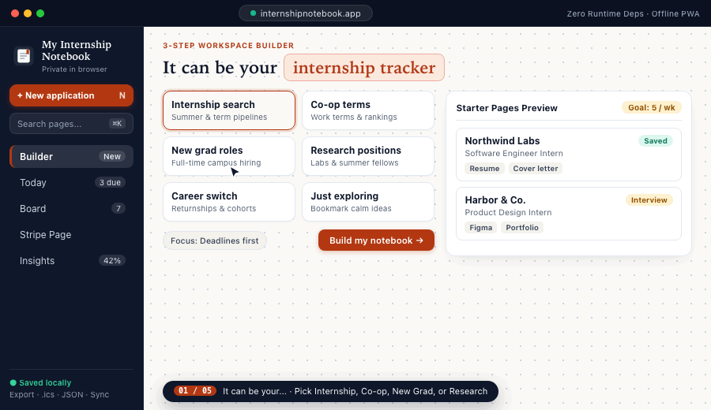

<div align="center">


# My Internship Notebook

**Every internship application, one calm notebook. Private, offline-first, and built your way.**

[](https://internshipnotebook.app/)
[](https://github.com/will-iam08/myinternshipnotebook/actions/workflows/deploy-pages.yml)
[](https://github.com/will-iam08/myinternshipnotebook/actions/workflows/update-internships.yml)
[](./package.json)
[](./docs/browser-extension.md)
[](./LICENSE)

[Launch App](https://internshipnotebook.app/) · [It Can Be Your...](#it-can-be-your) · [Features](#features) · [Editions & Sync](#editions-and-sync) · [Quick Start](#quick-start) · [Architecture](#architecture) · [Roadmap](#roadmap) · [Privacy](https://internshipnotebook.app/privacy.html)

<p>
  <a href="https://internshipnotebook.app/">
    
  </a>
</p>

<p>
  <sub>
    <a href="https://internshipnotebook.app/">Open the live app</a> ·
    <a href="https://internshipnotebook.app/#/welcome">Explore the interactive demo</a> ·
    <a href="https://internshipnotebook.app/#/build">Build your own workspace</a> ·
    <a href="./docs/browser-extension.md">Install the Save Jobs extension</a>
  </sub>
</p>

</div>

---

## What Is My Internship Notebook?

**My Internship Notebook** is a private, installable web app and browser companion designed like a tactile paper notebook: a deep-navy cloth sidebar cover, dot-grid overview pages, index-card application columns, and ruled paper pages for notes, contacts, and next steps.

Unlike bloated spreadsheets or hosted trackers that lock your search behind mandatory accounts, the public website runs with **zero runtime dependencies and zero backend**. Your records stay in your own browser storage, work cleanly offline as an installable PWA on desktop and mobile, and sync across devices only when you opt in.

---

## <a id="it-can-be-your"></a>It Can Be Your...

<div align="center">

<a href="https://internshipnotebook.app/#/build">
  
</a>

</div>

Your search does not fit a single spreadsheet template. The [3-step Workspace Builder](https://internshipnotebook.app/#/build) (`#/build`) adapts the Today dashboard, weekly goal, and optional starter pages around what you are actually pursuing, and shows an exact preview before anything is written:

| Track (`It can be your...`) | Built-In Starter Context | Default Weekly Goal | Focus Options Available |
| :--- | :--- | :---: | :--- |
| **Internship search** | Summer & term pipelines (`LinkedIn`, `Handshake`, portals) | 5 / week | **Deadlines first** (`Next up` leads Today) |
| **Co-op terms** | Work terms matching school schedules & rankings (`WaterlooWorks`) | 5 / week | **Track who replied** (Response rate first) |
| **New grad roles** | Early-cycle full-time & campus referral tracking | 6 / week | **Find new openings** (Daily feed up top) |
| **Research positions** | Lab outreach, papers read & reference letter tracking | 3 / week | **Prepare for interviews** (Active loops & questions first) |
| **Career switch** | Apprenticeships, returnships & portfolio case studies | 4 / week | **Keep it minimal** (Distraction-free essentials) |
| **Just exploring** | Low-pressure role bookmarks without weekly quotas | 2 / week | Start empty, from a template, or import existing rows |

Every starter page uses invented placeholder companies clearly labeled as examples so real listings never mix with demo data, and brand-new visitors can explore the full live workspace first on [`#/welcome`](https://internshipnotebook.app/#/welcome) in memory-only demo mode.

---

## Features

### Daily Workspace & Visual Pipeline
- **Today Command Center:** Personalized greeting, weekly application goal ring with day-by-day dots, compact **Next up** deadline radar, stale follow-up nudges (14+ days without a reply), and recently edited pages.
- **5-Stage Kanban Board:** Drag-and-drop index cards across **Saved**, **Applied**, **Interview**, **Offer**, and **Rejected** columns colored with a color-vision-deficiency-checked palette (`--st-*`), plus a quick **"Move to..."** menu and mobile stage tabs.
- **Ruled Notebook Pages:** Open any role on lined paper with instant autosave for company, role, location, source, closing date, posting link, contact, skill tags, long-form notes, undoable next-step completions, and an automatic dated timeline of every stage transition.
- **All Pages, Batch Actions & Safety Net:** Table-of-contents view with stage filters, stars, skill/note search, multi-select batch stage moves, `⌘K` / `Ctrl K` / `/` command palette (`N` for new page), Light & Dark WCAG 2.2 AA themes, and a 7-day **Recently Deleted** recovery bin with Undo toasts.

### Job Discovery & 1-Click Capture
- **Daily Global Openings Feed:** Browse fresh roles right inside Today, filter by **All**, **Canada**, **United States**, **Remote**, or **International** (with live counts), search role/company/location, filter by term/degree/co-op eligibility, and clip into a new page in one click.
- **Quick Fill Job Clipper:** Paste any job URL or posting text (Greenhouse, Lever, Ashby, Workday, LinkedIn, SmartRecruiters, Simplify) and automatically extract structured `JobPosting` metadata, location, closing date, and technical skills.
- **Save Jobs Browser Extension (`Chrome`, `Edge`, `Firefox`):** Click the toolbar button (or press `Alt+Shift+S`) on any posting to inspect parsed fields, keep a backup of the job description in notes before the listing expires, and send it to your notebook via the client-side `#/new` hash route. See [docs/browser-extension.md](./docs/browser-extension.md).
- **Universal Spreadsheet & Backup Import:** Bring trackers from Google Sheets, Notion, Excel, Simplify, or WaterlooWorks (`CSV`, `TSV`, or `JSON`). Smart header mapping normalizes stages, validates calendar dates and `http(s)://` links identically to typed entries, previews changes first, and supports full batch undo.

### Interview Prep & Timed Mock Coach
- **62-Question Role-Matched Bank:** Every application page includes 62 questions across four groups (**Behavioral**, **Technical**, **Internship Logistics**, and **Questions to Ask**) tailored to Software, Data, Design, or Product roles and reordered automatically by stage (technical before interviews, logistics once an offer lands). Track **Practiced** / **Stuck** progress and answer notes per application, plus surface your top 3 **Practice next** prompts on Today.
- **Timed Mock Interview Coach:** Practice in four structured session modes (`Quick` ~5 min, `Full` ~15 min, `Technical`, and `Behavioral`) with live answer timers, speaking-pace telemetry (100-180 WPM target band), filler-word detection, automatic STAR structure (`Situation`, `Task`, `Action`, `Result`) cue checks, a 0-100 readiness breakdown, and compact session history.

### Offline-First PWA, Reminders & Portability
- **Resilient Autosave Queue:** Every keystroke captures locally first. If storage is temporarily busy or you lose Wi-Fi mid-commute, pending saves queue and retry automatically with honest UI states (`Saving`, `Saved locally`, `Synced`, `Couldn't save`). Corrupted local storage is isolated into a recovery screen instead of silently erased.
- **Calendar Alerts & Exports (`#/export`):** Export a standard `.ics` file with 24-hour and 2-hour alerts for Google Calendar, Apple Calendar, or Outlook; open a pre-addressed **"Email me a digest"** draft directly in your own mail app; enable optional due-soon tab notifications; print/save PDFs; or export Markdown, CSV, and full JSON backups.
- **Installable Cross-Platform App:** Install to the macOS Safari Dock, iOS/Android Home Screen, or desktop Chrome/Edge with Web Share Target support to clip job links directly from other mobile apps.

---

## Editions and Sync

| Edition | Storage & Offline Support | Capture Integrations | Best For |
| :--- | :--- | :--- | :--- |
| **Website Edition (PWA)**<br/>`internshipnotebook.app` | Browser `localStorage` + network-first Service Worker | Daily Openings feed, Quick Fill, `CSV`/`TSV`/`JSON` import, Android Web Share | Daily personal tracking, phones & laptops, optional Supabase sync |
| **Save Jobs Extension**<br/>`_extension.zip` (MV3) | `chrome.storage` (URL + preference only; zero server calls) | Reads active tab schema.org `JobPosting` + `js/clipper.js` on click (`Alt+Shift+S`) | One-click saving from Greenhouse, Lever, Ashby, Workday & LinkedIn |
| **Local Java Server**<br/>`ApplicationServer` (`:8080`) | Single-user REST API backed by local `data/applications.tsv` | Same full HTML/CSS/JS frontend UI (`serverApi`) with atomic batch writes | Local development, TSV persistence, and Java backend extension |

<details>
<summary><strong>Cloud Sync &amp; Privacy Security Model (Supabase, Local Server &amp; Usage Counts)</strong></summary>

1. **Optional Supabase Sync (Browser Edition):**
   - Disabled unless the owner populates `src/main/resources/public/runtime-config.js` following [supabase/README.md](./supabase/README.md).
   - Uses plain `fetch` to Supabase Auth and PostgREST (no third-party SDK scripts).
   - **Settings -> Cloud sync** supports email/password account creation, sign-in, password-reset email request, and manual **Sync now**.
   - **Last-write-wins whole notebook:** syncs active and recently deleted pages, notes, stage history, interview progress/notes, and compact mock-interview history without merging individual pages. Preferences, drafts, credentials, and demo data never leave the browser; raw mock-interview transcripts are never persisted.
   - **Isolation & RLS:** Row Level Security (`supabase/schema.sql`) limits access strictly to the authenticated owner's row and rejects stale concurrent writes. Sessions remain strictly in memory (reloading or session expiry prompts a clean sign-in; existing Firebase accounts are not migrated automatically - transfer via JSON backup). Keep separate OS/browser profiles on shared devices.
2. **Private Aggregate Usage Counts (Optional):**
   - When configured ([supabase/USAGE.md](./supabase/USAGE.md)), the public site sends only a daily rotating random browser ID, an allowlisted page category, and a page-view flag to a write-only Supabase RPC - never notebook entries, account IDs, titles, URLs, or searches.
   - Settings provides a one-click opt-out, and **Do Not Track (DNT)** / **Global Privacy Control (GPC)** headers disable events automatically. Server and local/hidden modes emit nothing.
3. **Local Java API Hardening:**
   - Binds strictly to the loopback interface (`127.0.0.1`), rejects cross-site browser writes and non-JSON payloads, caps standard JSON bodies at `64 KiB` and imports at `5 MiB`, preserves atomic batch recovery, and halts startup if a corrupted storage line is encountered rather than overwriting user data. See [Privacy Policy](https://internshipnotebook.app/privacy.html) and [Delete Data Guide](https://internshipnotebook.app/delete-account.html).

</details>

<details>
<summary><strong>Where the Daily Internship Listings Come From</strong></summary>

A scheduled GitHub Action ([`.github/workflows/update-internships.yml`](./.github/workflows/update-internships.yml)) rebuilds `src/main/resources/public/internships.json` daily so visitors never wait on live third-party fetches:
- [**SimplifyJobs/Summer2027-Internships**](https://github.com/SimplifyJobs/Summer2027-Internships) (Pitt CSC & Simplify): listings JSON (primarily US openings).
- [**negarprh/Canadian-Tech-Internships-2027**](https://github.com/negarprh/Canadian-Tech-Internships-2027): structured table of Canada and remote-Canada tech roles. Because that repository has no license, `scripts/fetch-internships.mjs` retains only public posting facts (company, role, location, apply URL, date posted) and credits the source in-app.

The script deduplicates identical postings (company + title + work term), retains up to `60` newest Canadian roles, fills the remainder to `150` total with the newest Simplify postings, and classifies regions cleanly offline. Run `node scripts/fetch-internships.mjs` manually anytime to refresh locally.

</details>

---

## Quick Start

### Option 1: Launch & Install the Live Web App (Fastest)
1. Open **[internshipnotebook.app](https://internshipnotebook.app/)** in your browser.
2. Click **Explore the demo** on `#/welcome` or **Build my notebook** (`#/build`) to configure your workspace.
3. Install as an offline-capable app:
   - **Chrome / Edge:** Click the **Install** icon in the address bar.
   - **macOS Safari:** **File -> Add to Dock**.
   - **iPhone / iPad:** **Share -> Add to Home Screen**.

### Option 2: Load the Save Jobs Browser Extension (`Chrome`, `Edge`, `Firefox`)
**Prerequisites:** Node.js 22+.

```bash
git clone https://github.com/will-iam08/myinternshipnotebook.git
cd myinternshipnotebook
npm run build:extension
```
- **Chrome / Edge:** Open `chrome://extensions` (or `edge://extensions`), enable **Developer mode**, click **Load unpacked**, and select `_extension/`.
- **Firefox:** Open `about:debugging#/runtime/this-firefox`, click **Load Temporary Add-on**, and select `_extension/manifest.json`.

### Option 3: Build & Preview the Static Website Locally

```bash
npm run build   # outputs the browser-only PWA edition to _site/
npm run serve   # serves http://127.0.0.1:4173 locally
```

### Option 4: Run the Local Java API Edition

**Prerequisites:** Java 21 (JDK 21+). Data saves locally in `data/applications.tsv` (gitignored).

```bash
javac --add-modules jdk.httpserver -d out $(find src/main/java -name '*.java')
java --add-modules jdk.httpserver -cp out com.coopcompass.ApplicationServer
```
Then visit [http://localhost:8080](http://localhost:8080).

### Available Scripts & Testing

Development tooling lives strictly in `package.json`; **zero npm packages ship to the browser**.

| Command | Scope | Description |
| :--- | :--- | :--- |
| `npm run check` | Frontend & extension | Syntax-checks every `.js` / `.mjs` script (`node --check`) |
| `npm run test:unit` | Core logic & privacy | Runs 29 `node --test` suites covering `domain.js`, `clipper.js`, `builder.js`, `mock-interview.js`, `storage.js`, `cloud.js`, and extension parsing |
| `npm run test:e2e` | Full browser E2E | Runs 20 Playwright specs across both **Desktop Chromium** and **iPhone 13 WebKit** (`320`-`430px` viewports, PWA offline, security, routing, a11y) |
| `npm test` | Full CI frontend gate | Runs `check` + `test:unit` + `test:e2e` sequentially |
| `npm run build` | Production PWA | Copies public assets into `_site/` with `site-mode.js = "browser"` |
| `npm run build:extension` | Extension bundle | Packages `_extension/` and `_extension.zip` for CWS & AMO |
| `node scripts/fetch-internships.mjs` | Listings feed | Refreshes `internships.json` from curated GitHub internship lists |

Run the Java repository and security suites with:

```bash
javac --add-modules jdk.httpserver -d out $(find src/main/java src/test/java -name '*.java')
java --add-modules jdk.httpserver -ea -cp out com.coopcompass.ApplicationRepositoryTest
java --add-modules jdk.httpserver -ea -cp out com.coopcompass.ApplicationServerSecurityTest
```

---

## Architecture

One vanilla HTML/CSS/ES-Module UI speaks to one unified storage contract (`browserApi` in `localStorage` or `serverApi` over HTTP), backed by pure domain validation modules in `js/domain.js`:

```text
  Browser UI (Vanilla HTML/CSS/ES Modules + Service Worker offline cache)
        │
        ├── Browser Edition (Static PWA) ──> js/storage.js ──> localStorage (autosave + retry queue)
        │                                       └── optional manual fetch ──> Supabase Auth + PostgREST
        │
        ├── Save Jobs Extension (MV3) ───> activeTab + Schema.org/clipper.js ──> #/new?... (hash-local)
        │
        └── Java Server Edition (:8080) ─> js/api.js ──> ApplicationServer ──> ApplicationRepository ──> data/applications.tsv
```

### Repository Structure

```text
myinternshipnotebook/
├── src/main/java/com/coopcompass/   # Zero-dependency Java 21 HTTP server, JSON parser & TSV repository
├── src/test/java/com/coopcompass/    # Java repository & API security test suites
├── src/main/resources/public/        # Shared frontend PWA (index.html, styles.css, sw.js, manifest)
│   ├── js/                           # Pure logic & view modules (domain, builder, clipper, mock-interview, etc.)
│   └── media/                        # Welcome video tour (mp4/webm) & poster artwork
├── extension/                        # Cross-browser Save Jobs MV3 extension (Chrome, Edge, Firefox)
├── scripts/                          # Static builder, extension packer, syntax checker, demo recorder & feed updater
├── supabase/                         # Optional cloud sync SQL schemas & privacy-safe usage telemetry docs
├── tests/                            # 29 Node unit suites (tests/unit/) + 20 Playwright E2E specs (tests/e2e/)
├── docs/                             # Product decisions, extension guide, asset artwork (docs/assets/)
├── CONTRIBUTING.md                   # Contributor workflow & design rules
├── LICENSE                           # MIT License
└── .github/workflows/                # CI checks, GitHub Pages deploy & daily openings updater
```

### Engineering Highlights
- **Pure Testable Core:** `builder.js`, `clipper.js`, `domain.js`, `interview.js`, `mock-interview.js`, `listings.js`, and `landing.js` carry zero DOM or network dependencies so every validation edge case runs instantaneously under `node --test`.
- **Single Validation Path:** Imported rows (`CSV`/`TSV`/`JSON`), typed edits, extension clips, and demo templates all pass through identical sanitization (`sanitizeImportedEntry`, `cleanChanges`, `cleanLink`).
- **Dual-Viewport CI Verification:** Every commit to `main` validates Java tests, Node syntax/unit tests, and full Playwright journeys on both Desktop Chromium and iPhone 13 WebKit before deploying to Pages.

<details>
<summary><strong>Local Java REST API Reference &amp; GitHub Pages Deployment</strong></summary>

#### REST API Endpoints (`com.coopcompass.ApplicationServer`)

| Method | Path | Purpose |
| :--- | :--- | :--- |
| `GET` | `/api/applications` | List active applications |
| `POST` | `/api/applications` | Create a new application entry |
| `POST` | `/api/applications/import` | Atomically import active + recently deleted pages with original dates & stage history |
| `PATCH` | `/api/applications/{id}` | Partial update; automatically records stage changes on the timeline |
| `DELETE` | `/api/applications/{id}` | Move application to Recently Deleted |
| `POST` | `/api/applications/bulk-status` | Move multiple selected applications to a target stage |
| `POST` | `/api/applications/bulk-delete` | Move multiple selected applications to Recently Deleted |
| `GET` | `/api/recently-deleted` | List applications in Recently Deleted |
| `POST` | `/api/recently-deleted/{id}/restore` | Restore one entry (or `/bulk-restore` for batches) |
| `DELETE` | `/api/recently-deleted/{id}` | Permanently delete one entry (or `POST .../bulk-permanent-delete`) |
| `GET` | `/api/dashboard` | Compute stage counts, response rates, and insights summary |

#### GitHub Pages Setup

[`.github/workflows/deploy-pages.yml`](./.github/workflows/deploy-pages.yml) runs all Java and frontend/Playwright checks on every push and pull request, deploying `_site/` to [internshipnotebook.app](https://internshipnotebook.app/) on pushes to `main`. Before the first deploy, set **Settings -> Pages -> Build and deployment -> Source -> GitHub Actions** in your repository fork.

</details>

---

## Roadmap

### Shipped Milestones
- [x] **Tactile Notebook Workspace & Pipeline:** Today radar, 5-stage CVD-safe Kanban board, ruled application pages, batch moves, `⌘K` search, Light/Dark AA themes, and 7-day Undo safety net
- [x] **Zero-Backend Offline PWA & Java Server Parity:** Unified storage interface across `localStorage`, Service Worker offline caching, autosave retry queue, and single-user Java 21 REST server
- [x] **Adaptable Workspace Builder & Live Demo:** `"It can be your..."` 3-step customizer (`#/build`) across 6 search paths plus zero-persistence live demo (`#/welcome`)
- [x] **Daily Openings Feed & 1-Click Clipping:** Automated daily US/Canada/Remote feed + Schema.org job parser + cross-browser **Save Jobs Extension** (`Chrome`, `Edge`, `Firefox`) + Universal `CSV`/`TSV`/`JSON` import
- [x] **Interview Prep & Timed Mock Coach:** 62 role-aware questions + timed mock sessions with WPM pace, filler detection, STAR coverage checks, and `.ics` / digest calendar reminders
- [x] **Optional Supabase Cloud Sync:** User-owned email/password sync backed by Row Level Security + privacy-respecting aggregate page telemetry

### Up Next
- [ ] **PostgreSQL + Flyway Storage Adapter:** Production multi-user SQL backend implementing the `ApplicationStore` interface alongside TSV persistence
- [ ] **Spring Boot API & JUnit Suite:** Typed Spring controllers, Bean Validation, and integration test suite
- [ ] **React + TypeScript Frontend Option:** Optional typed UI layer sharing the same design tokens and validation contracts
- [ ] **Live Multi-Device Conflict Detection:** Real-time detection when two signed-in browser sessions edit concurrently
- [ ] **Scheduled Server Reminders & Settings Controls:** Background email/push reminders while closed, plus editing builder focus areas directly inside Settings

---

## Contributing

Contributions, bug fixes, job-board parser improvements, and accessibility refinements are always welcome! Read [CONTRIBUTING.md](./CONTRIBUTING.md) and [docs/product-decisions.md](./docs/product-decisions.md) before opening a pull request, or browse open [Issues](https://github.com/will-iam08/myinternshipnotebook/issues).

---

## License

Released under the [MIT License](./LICENSE).
